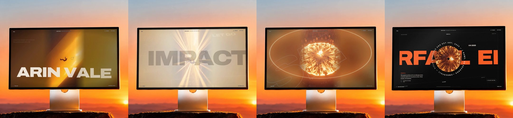

# Anirudh P — Freefall Portfolio

A single-page cinematic portfolio for **Anirudh P** (Computer Science Engineer & Creative Technologist), told as one fall. Scrolling drives everything: dual-film frame scrubbing, 3D kinetic typography, synthesized Web Audio engine, and an interactive editorial spotlight.



Watch the full walkthrough: [showcase/freefall-showcase.mp4](showcase/freefall-showcase.mp4) (111 s, 1080×1920, with sound).

---

## The Journey, in Scroll Order

1. **Loader.** A thin gold line fills while frames load in coarse-to-fine sequence, with sound choice.
2. **The Leap.** A figure falls through a shaft of light. 3D kinetic typography flies past with scroll momentum and cursor tilt.
3. **Impact.** Whiteout flash, screen shake, and synthesized sub-bass boom.
4. **The Noise.** Landing in a crowd of noise and conventional code, blown away by a fiery shockwave.
5. **Rise.** R-I-S-E assembles out of the depth.
6. **Index.** The film compresses into one 3D tile among floating project covers and Anirudh's 3D card.
7. **Selected Work.** Four 3D case screens stack and recede, each with spinning vinyl discs and circular typography:
   - **JusticeAI**: Offline-first private legal co-pilot for Indian citizens powered by local LLMs (Ollama, Gemma) & RAG.
   - **FreightIQ NOVEX**: Dynamic freight rate prediction and market volatility forecasting engine.
   - **Project EUPHORIA**: Full-screen 10-scene narrative web experience built with Next.js & motion choreography.
   - **Pixels in Frame**: Documentary photography and visual storytelling exploring urban light and human rhythm.
8. **About & Manifesto.** Scroll-luminosity manifesto lighting up word-by-word, dual-direction velocity marquee, and an **Editorial Spotlight Card** with live telemetry.
9. **Services.** Core engineering offerings with cursor-tracking image preview cards.
10. **The Portal.** Walking through a burning doorway in the clouds as 3D arches rush past.
11. **Contact.** Direct email, Bangalore live clock (IST), and "Fall again" rewind control.

---

## Quick Start

Serve the project with any local server and open it in your browser:

```bash
# Python
python -m http.server 8000

# or Node / npx
npx serve .
```

Then visit [http://localhost:8000](http://localhost:8000).

---

## Project Structure

```
├── index.html            Markup, layout, copy & project cases
├── css/style.css         Styles, design tokens & editorial spotlight card
├── js/main.js            Scroll engine: Lenis, dual-film scrubber, 3D type, Web Audio
├── assets/
│   ├── fall/             465 WebP frames of the vertical falling film (30 fps)
│   ├── portal/           239 WebP frames of the horizontal portal film (24 fps)
│   └── custom/           Anirudh's cinematic portraits & photography artwork
└── showcase/             Showcase video, composites & telemetry tracks
```

---

## Tech Stack

- **Graphics & Motion**: Canvas 2D, CSS 3D Transforms, WebP frame scrubbing, Lenis smooth scrolling
- **Audio**: Web Audio API (Synthesized bandpass wind noise, multi-oscillator drone, exponential bass sweep)
- **Design Tokens**: Archivo & Instrument Serif typography, darkroom palette (`--void`, `--molten`, `--ember`, `--bone`)

---

## License & Credits

Built with gravity by **Anirudh P**.
Design inspired by the Freefall portfolio architecture.
